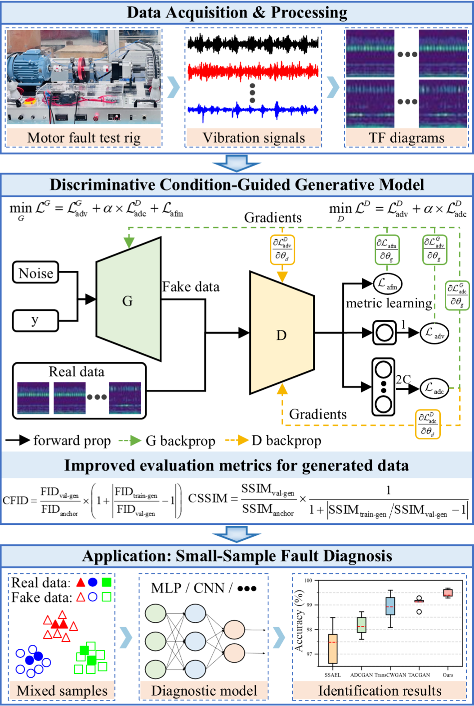

# DCGM-IFD

This repository contains the implementation of our paper titled [Discriminative Condition-Guided Generative Model for Induction Motor Fault Diagnosis with Limited Data](https://ieeexplore.ieee.org/document/11278460). 

## Abstract

The scarcity of fault samples degrades the accuracy of data-driven intelligent fault diagnosis (IFD). An auxiliary classifier generative adversarial network (GAN) has therefore emerged as a dominant paradigm for generating multiclass data to mitigate this issue; however, this framework suffers from low intraclass diversity and gradient instability. Specifically, the classifier's strong class-label separability compresses the category's support space, reducing diversity and also causing optimization conflicts. To this end, this article proposes a discriminative condition-guided generative model (DCGM) to synthesize high-fidelity data across categories for induction motor fault diagnosis under small-sample conditions. First, a discriminative classifier is integrated into the conditional GAN to replace the auxiliary classifier, theoretically alleviating diversity constraints and instability. After that, an adaptive feature matching loss based on supervised contrastive learning is proposed to enhance the synthetic quality of the class-label data. Then, three novel evaluation metrics are developed to quantitatively assess the generated data quality. Extensive experiments on induction motor datasets demonstrate that DCGM achieves state-of-the-art evaluation scores compared to diffusion-, transformer-, and GANs-based models. Finally, small-sample fault diagnosis further validates the superiority of the proposed approach, highlighting its potential in engineering applications. To the best of our knowledge, this is the first to introduce the novel discriminative generative framework for conditional data generation in the IFD field.

## Graphical Abstract




## Repository Structure

The following tree summarizes the main files and directories in the project.

```
.
|-- README.md
|-- __init__.py
|-- datasets
|   `-- Motor
|-- graphical_abstract.png
|-- logs
|   `-- Motor
|-- models
|   |-- classification_models.py
|   `-- ours_model.py
|-- scripts
|   `-- train.sh
|-- train_cls.py
|-- train_gan.py
`-- utils
    |-- __init__.py
    |-- losses.py
    |-- read_cwt_figures.py
    |-- sn_layers.py
    |-- supcontrast_loss.py
    `-- utils.py
```


| Path | Purpose |
|---|---|
| `train_gan.py` | Entry point for training the DCGM generative model. |
| `train_cls.py` | Entry point for training the downstream classification model. |
| `models/ours_model.py` | Implementation of the proposed model. |
| `models/classification_models.py` | Classification-model definitions. |
| `utils/losses.py` | Loss-function implementations. |
| `utils/supcontrast_loss.py` | Supervised contrastive loss implementation. |
| `utils/sn_layers.py` | Spectral-normalization-related layers. |
| `utils/read_cwt_figures.py` | Utilities for reading CWT image data. |
| `scripts/train.sh` | Shell script for launching generative-model training. |
| `datasets/Motor/` | Location for the motor dataset. |
| `logs/Motor/` | Directory reserved for motor-experiment logs; actual output paths depend on the training configuration. |

## Usage

### Requirements

* Python: 3.8.16
* PyTorch: 2.0.0+cu118
* Torchvision: 0.15.0+cu118
* CUDA: 11.8
* CUDNN: 8700
* NumPy: 1.23.4
* PIL: 10.0.1

### Data preparation

The data utilized in this study is proprietary; however, anyone can prepare their own dataset by adhering to the following directory structure

```
./datasets/Motor/real_images/
├── test
│   ├── 0-0.jpg
│   ├── 1-0.jpg
...
│   ├── 100-1.jpg
...
├── train
│   ├── 0-0.jpg
│   ├── 1-0.jpg
...
│   ├── 200-1.jpg
...
└── valid
    ├── 0-0.jpg
    ├── 1-0.jpg
    ...
```

### Training

**1. Train the DCGM generative model**

Using the provided shell script:

```bash
bash scripts/train.sh
```

Alternatively, launch the Python entry point directly:

```bash
python train_gan.py
```

The shell script and Python entry point are the available training interfaces documented in this repository. Review their arguments and configuration before training if you need to change the dataset path, hyperparameters, device, or output locations.

**2. Train the downstream classifier**

To train the ResNet-based classifier for the downstream fault-diagnosis task, run:

```bash
python train_cls.py
```

## Related Work and Acknowledgements

We acknowledge the authors and developers of the following works for their valuable contributions to generative adversarial networks and contrastive learning, which have informed the development of this project.

* **Conditional GANs with Auxiliary Discriminative Classifier (ADC-GAN) [1]:** We adopt the auxiliary discriminative classifier concept and incorporate an auxiliary classifier into our conditional generative adversarial network framework for fault diagnosis of induction motor.
* **Supervised Contrastive Learning (SupCon Loss) [2]:** This work provides the methodological foundation for the supervised contrastive loss used in this project. We integrate the `SupCon loss` into the generator objective to encourage generated samples to exhibit more discriminative and class-consistent features.
* **StudioGAN [3] and the survey on GAN conditioning methods [4]:** These works provide useful background on GAN architectures and conditioning strategies, which have informed the design of our conditional generative model.

[1] L. Hou, Q. Cao, H. Shen, S. Pan, X. Li, X. Cheng, Conditional GANs with auxiliary discriminative classifier, in: Proceedings of the 39th International Conference on Machine Learning, PMLR, 2022: pp. 8888–8902.  [[Paper](https://proceedings.mlr.press/v162/hou22a.html)]

[2] P. Khosla et al., “Supervised contrastive learning,” in *Proc. Adv. Neural Inf. Process. Syst.*, 2020, pp. 18661–18673. [ [Paper](https://proceedings.neurips.cc/paper_files/paper/2020/hash/d89a66c7c80a29b1bdbab0f2a1a94af8-Abstract.html)]

[3] M. Kang, J. Shin, J. Park, StudioGAN: a taxonomy and benchmark of GANs for image synthesis, IEEE Transactions on Pattern Analysis and Machine Intelligence, 45 (2023) 15725–15742.  [[Paper](https://ieeexplore.ieee.org/abstract/document/10224337)]

[4] A. Bourou, V. Mezger, A. Genovesio, GANs conditioning methods: a survey, arXiv Preprint arXiv:2408.15640 (2024). [[Paper](https://arxiv.org/abs/2408.15640)]

## Further Reading on GAN Evaluation and Generalization

Evaluating the quality of generated samples is an important aspect of generative modeling. Beyond visual fidelity, evaluation should also consider sample diversity, distributional similarity, and the model's ability to generalize beyond the training data. The following works provide further reading on GAN evaluation metrics, statistical tests for comparing data distributions, training-sample memorization, and related generative modeling methods.

[5] A. Borji, “Pros and cons of GAN evaluation measures,” Comput. Vision Image Understanding, vol. 179, pp. 41–65, 2019.

[6] A. Borji, “Pros and cons of GAN evaluation measures: New developments,” Comput. Vision Image Understanding, vol. 215, p. 103329, 2022.

[7] D. Lopez-Paz and M. Oquab, “Revisiting classifier two-sample tests,” Mar. 13, 2018, arXiv: 1610.06545.

[8] J. Yang, A. Kannan, D. Batra, and D. Parikh, “LR-GAN: layered recursive generative adversarial networks for image generation,” Aug. 02, 2017, arXiv: 1703.01560.

[9] S. Liu, Y. Wei, J. Lu, and J. Zhou, “An improved evaluation framework for generative adversarial networks,” July 19, 2018, arXiv: 1803.07474.

[10] C.-Y. Bai, H.-T. Lin, C. Raffel, and W. C. Kan, “On training sample memorization: Lessons from benchmarking generative modeling with a large-scale competition,” in Proceedings of the 27th ACM SIGKDD Conference on Knowledge Discovery & Data Mining, Virtual Event Singapore: ACM, Aug. 2021, pp. 2534–2542.

[11] I. Gulrajani, C. Raffel, and L. Metz, “Towards GAN benchmarks which require generalization,” Jan. 10, 2020, arXiv: 2001.03653.

[12] Z. Zhang, Y. Song, and H. Qi, “Decoupled learning for conditional adversarial networks,” in 2018 IEEE Winter Conference on Applications of Computer Vision (WACV), IEEE, 2018, pp. 700–708.

[13] D. J. Im, C. D. Kim, H. Jiang, and R. Memisevic, “Generating images with recurrent adversarial networks,” Dec. 13, 2016, arXiv: 1602.05110.

## Citation

If you find our work is relevant to your research, please cite:

```
@article{chen2026discriminative,
  title = {Discriminative Condition-Guided Generative Model for Induction Motor Fault Diagnosis with Limited Data},
  author = {Chen, Xin and Chen, Zaigang and Xin, Junsheng and Guo, Liang and Zhai, Wanming},
  year = 2026,
  journal = {IEEE Transactions on Industrial Informatics},
  volume = {22},
  number = {2},
  pages = {1359--1370},
  doi = {10.1109/TII.2025.3626126}
}
```

X. Chen, Z. Chen, J. Xin, L. Guo, W. Zhai, Discriminative condition-guided generative model for induction motor fault diagnosis with limited data, IEEE Transactions on Industrial Informatics, 22 (2026) 1359–1370. 

## Contact

For questions about the implementation or the paper, please contact:

- **Xin Chen**
- `chenxinnpu [at] gmail.com`
- `chenxin2022 [at] my.swjtu.edu.cn`